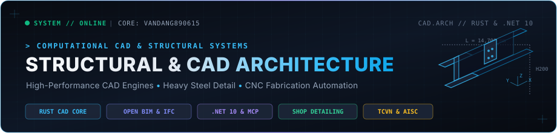

<!-- Custom Engineered Hero Banner -->

  

  <a href="README.md">English</a> &bull;
  <a href="README.vi.md">Tiếng Việt</a> &bull;
  <a href="README.ru.md">Русский</a> &bull;
  <a href="README.zh.md">中文</a> &bull;
  <b>فارسی</b>

---

### درباره من

**ون دانگ (Van Dang)** — مهندس سازه و توسعه‌دهنده هسته نرم‌افزارهای CAD/BIM.

تمرکز بر تحلیل سازه‌های فولادی سنگین صنعتی و توسعه زیرساخت‌های نرم‌افزاری مهندسی:
- **مهندسی سازه‌های فولادی:** طراحی و تهیه نقشه‌های شاپ‌دراوینگ سازه‌های صنعتی سنگین مطابق با استانداردهای AISC، Eurocode و TCVN؛ مدلسازی پیشرفته در Tekla Structures، طراحی اتصالات و بهینه‌سازی برش قطعات برای ماشین‌آلات CNC کارخانه.
- **توسعه هسته CAD/BIM:** مشارکت در توسعه موتور گرافیکی و پردازش متون در نرم‌افزارهای متن‌باز CAD با زبان **Rust** ([OpenCADStudio](https://github.com/HakanSeven12/OpenCADStudio), [SolidCraft](https://github.com/tangency-labs/solidcraft))؛ ساخت موتور مستقل CAD بر پایه **.NET 10** ([VNCAD](https://github.com/vandang890615/vncad))؛ و اتوماسیون فرایندهای نقشه‌کشی با پروتکل **MCP**.
- **اتوماسیون و ابزارسازی:** توسعه سامانه‌های برنامه‌ریزی تولید کارخانجات اسکلت فلزی، استخراج خودکار لیستوفر (BOM) و برنامه‌نویسی با زبان‌های Python و AutoLISP.

---

### مشارکت در پروژه‌های متن‌باز

مشارکت در توسعه نرم‌افزارهای بین‌المللی CAD و الگوریتم‌های هندسه سه‌بعدی:

| Project | Pull Request | Contribution Details | Stack | Status |
|:---|:---:|:---|:---:|:---:|
| [**OpenCADStudio**](https://github.com/HakanSeven12/OpenCADStudio) | [#2069](https://github.com/HakanSeven12/OpenCADStudio/pull/2069) | Resolved DXF MTEXT paragraph indentation and tab-stop displacement in drawing units | `Rust` `CAD Engine` `DXF` |  |
| [**OpenCADStudio**](https://github.com/HakanSeven12/OpenCADStudio) | [#1960](https://github.com/HakanSeven12/OpenCADStudio/pull/1960) | Initial localized text resource bundle integration | `Rust` `Fluent i18n` |  |
| [**SolidCraft**](https://github.com/tangency-labs/solidcraft) | [#5823](https://github.com/tangency-labs/solidcraft/pull/5823) | Complete Vietnamese (`vi`) localization catalog for v0.21.0 (2,385 / 2,385 keys) | `Rust` `3D CAD` `i18n` |  |
| [**SolidCraft**](https://github.com/tangency-labs/solidcraft) | [#2915](https://github.com/tangency-labs/solidcraft/pull/2915) | Added Vietnamese (`vi`) localization support for pure Rust parametric 3D CAD | `Rust` `3D CAD` `i18n` |  |

---

### مهارت‌ها و ابزارها

#### زبان‌های برنامه‌نویسی و محیط‌های توسعه

  

 

#### مهندسی سازه، CAD و BIM
| حوزه | نرم‌افزارها و ابزارها | محورهای تخصصی |
|:---|:---|:---|
| **موتورهای CAD** | OpenCAD Studio, AutoCAD, FreeCAD | رندرینگ شتاب‌یافته گرافیکی با Rust (wgpu)، اتولیسپ (AutoLISP)، آبجکت‌ای‌آراکس (ObjectARX)، خط لوله DXF/DWG |
| **مدلسازی BIM** | Tekla Structures, Autodesk Revit, Blender | شاپ اسکلت فلزی، رابط Tekla Open API، لیستوفر و خروجی CNC |
| **بک‌اند و سیستم‌ها** | .NET 10, FastAPI, SQLite, PostgreSQL | موتورهای پردازش مهندسی سریع، سرورهای MCP، الگوریتم‌های محاسبات هندسی |

---

### سامانه‌ها و پروژه‌های شاخص مهندسی

موتورهای محاسباتی و نرم‌افزارهای فنی توسعه داده شده توسط معمار اصلی:

| سامانه / نرم‌افزار | استک | شرح قابلیت‌ها و تمرکز فنی | نقش / وضعیت |
|:---|:---:|:---|:---:|
| **VNCAD Engine** | `.NET 10` `C#` `MCP` | موتور محاسباتی سبک و قدرتمند CAD منطبق با استانداردهای سازه و ترسیم خودکار نقشه با هوش مصنوعی MCP. | طراح و معمار اصلی / در حال توسعه |
| **Structural Fabrication Twin** | `FastAPI` `Python` `Tekla` | سامانه دیجیتال برای خط تولید کارخانجات اسکلت فلزی، زمان‌بندی گانت وکتور و خط لوله داده CNC. | نویسنده / استقرار عملیاتی |
| **VietStruct Detailing Suite** | `AutoLISP` `.NET` `Python` | ابزارهای اتوماسیون نقشه‌کشی سازه، شاپ اتصالات پارامتریک فولادی و انطباق با استانداردهای TCVN/AISC. | نویسنده / استقرار عملیاتی |
| **Material Takeoff & BBS Engine** | `Python` `PyQt5` `SQLite` | الگوریتم‌های استخراج خودکار لیستوفر آهن‌آلات و آرماتوربندی (BOM)، جدول خم و برش میلگرد (BBS) و برآورد هندسی سازه. | نویسنده / استقرار عملیاتی |

---

### ارتباط با من

&nbsp;&nbsp;

